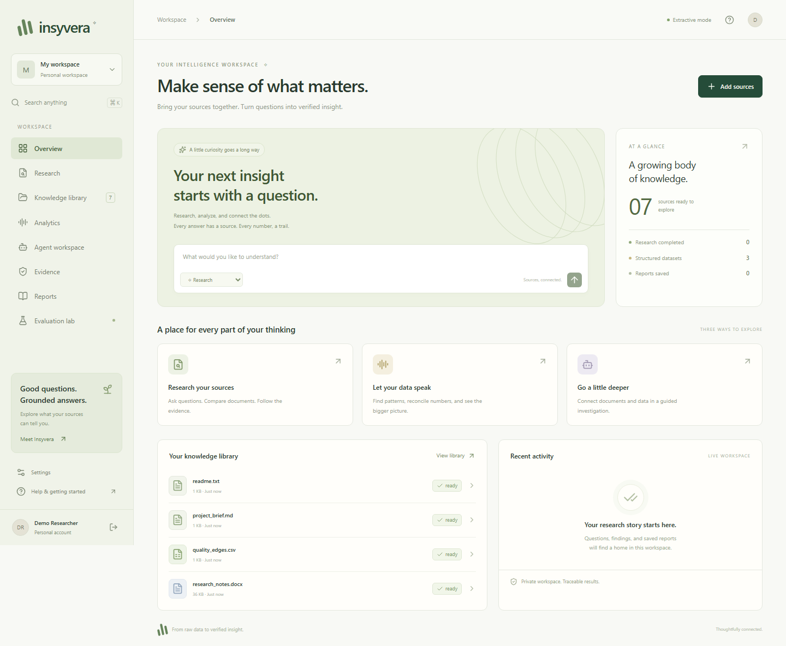

# Insyvera

**From raw data to verified insight.**

A locally runnable research and data intelligence workspace built with React, TypeScript, FastAPI, LangGraph, SQLAlchemy, PostgreSQL/pgvector, Celery, Redis, and MinIO.

Upload mixed documents and datasets, ask questions, execute reproducible calculations, follow evidence back to its source, and save versioned reports. The interface includes a knowledge library, research workspace, analytics studio, evidence ledger, agent timeline, report studio, and evaluation lab.



## Start here on Windows

The current checkout already has dependencies installed. To start local development:

```powershell
cd C:\Users\PC\Projects\insyvera
.\infrastructure\scripts\start-dev.ps1
```

Open **http://127.0.0.1:5180** and create an account. Accounts are private; there is no shared default password. Choose **Explore demo sources** on the overview page.

If port 5180/8100 is already in use by this checkout, use the running app instead of starting a second copy.

For a fresh checkout, install Python 3.12–3.13, Node 24, and Git, then run:

```powershell
python -m venv .venv
.\.venv\Scripts\python.exe -m pip install -r requirements.lock
.\.venv\Scripts\python.exe -m pip install -e . --no-deps
npm ci
npm --prefix apps/web ci
.\infrastructure\scripts\start-dev.ps1
```

The local development mode uses SQLite, local object files, synchronous jobs in API background tasks, keyword retrieval, and extractive answers. It is a working offline-capable mode after dependencies are installed. Docker supplies the full infrastructure configuration below.

On Linux/WSL, use `.venv/bin/python`; run the API and web server in two terminals:

```bash
python3 -m venv .venv
.venv/bin/python -m pip install -r requirements.lock
.venv/bin/python -m pip install -e . --no-deps
npm ci
npm --prefix apps/web ci
.venv/bin/python -m uvicorn app.main:app --host 127.0.0.1 --port 8100
# second terminal:
npm --prefix apps/web run dev
```

## The complete demo

All demo data is fictional.

1. Create an account and load the seven demo sources from Overview.
2. Open the library. Inspect the PDF, DOCX, XLSX, CSV, Markdown, and TXT previews.
3. In Research, choose **Deep investigation** and ask:
   > Compare my tax records, identify mismatches, and analyze Christmas gift spending.
4. Inspect the reproducible results:

| Finding | Expected |
|---|---:|
| Recorded income | EUR 84,000 |
| Recorded expenses | EUR 18,000 |
| Income minus recorded expenses | EUR 66,000 |
| Reported income | EUR 84,500 |
| Income discrepancy | EUR 500 |
| Gift spending | EUR 570 |
| Gift budget | EUR 500 |
| Over budget | EUR 70 |

5. Follow a PDF citation and a calculation's worksheet/cell link.
6. Inspect the deadline conflict: April 15 versus April 30. Neither source is automatically declared correct.
7. Create a report, edit it, save a new version, and export Markdown, PDF, or DOCX.
8. Open Analytics to group spending, inspect missing values, preview cleaning, join/filter datasets, examine correlations/trends, or create charts.
9. Run the five-case synthetic benchmark in Evaluation Lab.
10. Ask **What is my secret bank password?** in Research mode. The app should abstain.

Income minus recorded expenses is a demonstration metric, not a determination of legally deductible expenses or available cash.

## What works

- Cookie-based accounts, expiring hashed sessions, logout, and private workspace switching.
- Collections, source previews, immutable originals, version history, extracted-content comparisons, reprocessing, and deletion.
- PDF pages, Word paragraphs/tables, spreadsheet sheets/cells/formulas/cached values, CSV, Markdown and TXT parsing.
- Type/missing-value/duplicate/anomaly profiles, with explicit warnings for merged cells and missing formula caches.
- Permission-scoped keyword retrieval; PostgreSQL FTS and pgvector rank fusion when a real embedding provider is configured.
- Grounded extractive answers without an API key, plus optional Ollama and OpenAI-compatible model/embedding adapters.
- Deterministic decimal aggregates, filtering, joins, descriptive statistics, Pearson correlation, observed linear trends, and cleaning previews.
- Isolated allowlisted operation workers, source/operation/executor hashes, saved analyses and replay.
- Interactive bar, line, histogram and scatter charts with underlying records and CSV export; Plotly's chart toolbar supports image downloads.
- LangGraph planner/retriever/analyst/synthesizer/verifier/supervisor stages, durable checkpoints, cancellation, resumption and per-run process locks.
- Citation and quotation checks, calculation provenance, potential contradiction flags, and unavailable-source warnings.
- Versioned editable reports and Markdown/PDF/DOCX exports.
- Basic calculator and optional approval-gated public HTTPS retrieval with pinned DNS resolution and no redirect following.
- Separate retrieval, numerical, citation, abstention and contradiction benchmark scores.
- Audit events, structured request logs, readiness checks, optional OpenTelemetry export, backup tools and CI definitions.

## Full Docker stack

**No cloud deployment has been performed.** Docker Desktop must be running in Linux-container mode.

```powershell
.\infrastructure\scripts\bootstrap.ps1
docker compose up --build -d --wait --wait-timeout 300
docker compose exec api python infrastructure/scripts/check_infrastructure.py
```

The bootstrap script creates random local database/storage credentials only when `.env` is absent. Existing configuration is preserved.

| Service | Address |
|---|---|
| Web | http://localhost:5180 |
| API | http://localhost:8100 |
| OpenAPI | http://localhost:8100/docs |
| PostgreSQL, Redis, MinIO | Private Compose network; no host ports published |

The `insyvera` Compose project and dedicated named volumes keep this project separate from Nexus and Velqora. Only web/API ports are published, bound to loopback. Change `WEB_PORT` and `APP_PORT` in `.env` to avoid collisions.

### Local AI

In Docker, point `OLLAMA_URL` at your host Ollama server or enable the inference profile:

```powershell
docker compose --profile inference up -d ollama
docker compose exec ollama ollama pull qwen3:8b
docker compose exec ollama ollama pull nomic-embed-text
```

Then set:

```dotenv
MODEL_PROVIDER=ollama
MODEL_ID=qwen3:8b
OLLAMA_URL=http://ollama:11434
EMBEDDING_PROVIDER=ollama
EMBEDDING_MODEL=nomic-embed-text
EMBEDDING_DIMENSIONS=768
```

Recreate API/worker and reprocess existing sources. Model downloads require network access and disk space; model performance depends on hardware. An 8B model can require several GB of RAM/VRAM. Start with extractive mode on constrained hardware.

Embedding dimensions are part of the database schema. Changing dimensions requires a deliberate database migration and reindex, not just an environment-variable edit. HNSW is configured for vectors up to 2,000 dimensions; higher-dimensional configurations use exact search.

### Hosted models

Set `MODEL_PROVIDER=openai`, `MODEL_ID`, `OPENAI_URL` and `OPENAI_API_KEY` on the server. Embeddings are configured separately. Source passages are sent to the selected hosted provider when that mode is used; keep extractive/Ollama mode for local processing. API keys never reach browser configuration.

The server reads process environment variables. Docker Compose reads `.env`; local Python development does not automatically load it. Set PowerShell environment variables explicitly when using a hosted or local model outside Docker.

## Verification

```powershell
.\.venv\Scripts\python.exe -m ruff check apps/api tests
.\.venv\Scripts\python.exe -m pytest -q
npm run build
npx playwright install chromium
npm run test:e2e
```

Or use `infrastructure/scripts/verify.ps1 -Browser`. Infrastructure verification requires the running Compose stack and `-Infrastructure`.

Tests cover independent exact numeric expectations, cross-workspace access, all formats, immutable versions, source deletion, report exports/concurrency, prompt injection, operation restrictions, checkpoint recovery, cancellation races, chart replay and local backup/restore. Browser tests exercise the full application, exports and mobile layout.

The dependency lockfiles are committed. `npm audit` and the measured verification record are documented in [implementation status](docs/IMPLEMENTATION_STATUS.md). CI definitions are supplied; a workflow file is not evidence that hosted CI has run.

## Backup and recovery

For local mode, stop application processes before taking an offline backup:

```powershell
.\.venv\Scripts\python.exe -m app.maintenance backup .local\backups\local.tar.gz
.\.venv\Scripts\python.exe -m app.maintenance restore .local\backups\local.tar.gz --destination data-restored
```

Restore verifies file hashes and refuses a non-empty destination. Point a stopped app's `DATA_DIR` and `DATABASE_URL` at the restored directory when switching to it. Protect backup files: they include private source data and account/session records.

For Compose, use `infrastructure/scripts/backup.ps1`. It quiesces API/worker/web, captures PostgreSQL, MinIO data and checkpoints, then restarts the app. Restore into a separate, empty stack following [operations](docs/OPERATIONS.md). The Compose backup/restore procedure remains an infrastructure release gate until tested with a working Docker daemon.

## Important boundaries

- Default extractive mode finds and quotes matching evidence. It is not a substitute for a language model's broader interpretation.
- Model-written claims remain **needs review** even when their exact quotations resolve. Citation existence does not prove entailment or truth.
- Numeric operations are selected explicitly or through bounded heuristics. Reconciliation only aligns supported labels with matching period and currency; ambiguous units are not converted silently.
- Scanned PDFs need OCR outside this build. Arbitrary Excel formulas are not recalculated; missing caches stay missing.
- Cleaning previews create derived results and never rewrite uploads.
- Arbitrary model-generated Python is intentionally not accepted. The executor supports reviewed operations; it is not a general hostile-code jail.
- Potential textual contradictions use a limited, disclosed label-based detector. They require source/context review.
- The small evaluation suite is a regression aid, not a general AI-quality guarantee.
- Local demo throughput does not establish production scale.
- Full infrastructure, real-model inference, fresh-machine startup and deployment verification are recorded separately in [status](docs/IMPLEMENTATION_STATUS.md).

## Project map

```text
apps/api/app       API, identity, ingestion, retrieval, analytics, research and reports
apps/api/migrations Alembic migration history
apps/web          React and TypeScript workspace
apps/sandbox      Optional additional operation-container boundary
datasets          Synthetic demo files and labeled expectations
tests             Unit, API, security, resilience and browser acceptance
infrastructure    Docker, startup, verification, backup and telemetry
docs              Architecture, decisions, operations and verification evidence
```

See [architecture](docs/architecture/ARCHITECTURE.md), [API guide](docs/API.md), [security model](SECURITY.md), and the original [development roadmap](INSYVERA_DEVELOPMENT_ROADMAP.md).

**Author:** Andi Ferataj · [GitHub](https://github.com/andiferataj)
