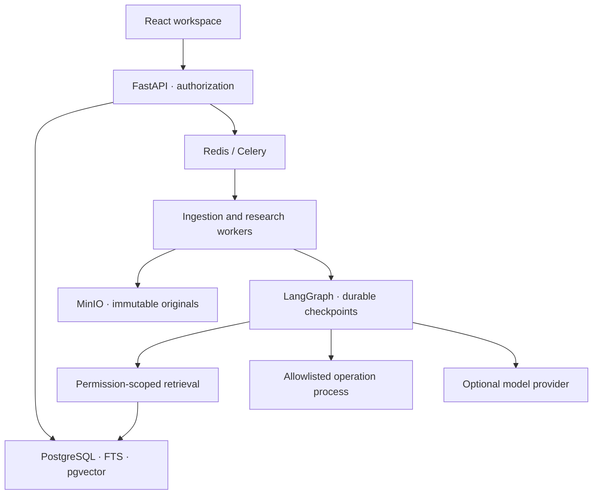
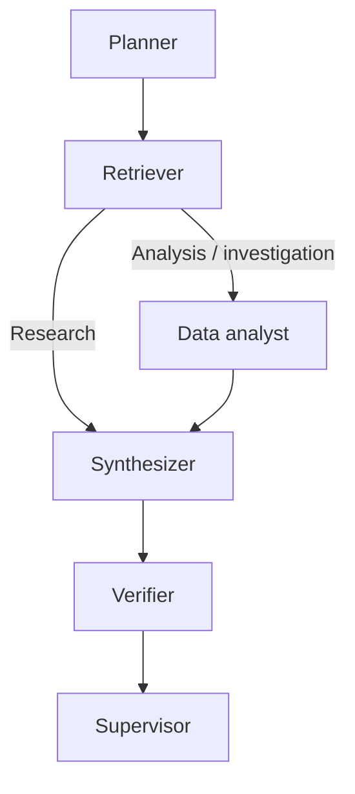

# Architecture and trust boundaries

## Runtime

Insyvera is a modular FastAPI application plus separate Celery workers. React communicates through a same-origin API proxy. SQLAlchemy persists accounts, memberships, sources/versions/chunks, runs/steps, analyses, reports/versions, evaluations, approvals and audit events.

The lightweight development profile replaces PostgreSQL with SQLite, MinIO with local objects, and Celery dispatch with API background tasks. This profile explicitly identifies keyword/extractive retrieval. It does not pretend to have vector semantics.

## Upload to evidence

1. Validate extension, signatures, archive contents, expanded sizes, text encoding and upload bounds.
2. Write an immutable original under workspace/document/version UUIDs; record SHA-256.
3. Parse pages, paragraphs and tables. Spreadsheets retain worksheet, row, cell-range, formula and cached-value metadata.
4. Profile structured records and emit disclosed warnings.
5. Chunk extracted units without discarding source-location metadata.
6. Optionally embed with an explicit model ID and dimension contract.
7. Search active/latest source versions with workspace predicates inside the SQL selection.
8. Return stable chunk IDs; open citations by re-resolving ownership against the database.

Reprocessing replaces a version's chunk index atomically. Old saved chunk references may become unavailable; the UI surfaces that state. Version originals remain unchanged.

## Retrieval

Local mode implements BM25 keyword ranking. PostgreSQL uses full-text ranking and pgvector cosine distance. Matching ranks are merged with reciprocal rank fusion (constant 60). Semantic results are admitted only for the configured embedding model and dimensions.

Candidates are restricted to authorized workspace/document/version/collection scope before ranking. The current implementation caps the candidate scan at 20,000 chunks. This is a documented portfolio-scale bound, not an unlimited corpus architecture.

## Research graph

Each graph node produces bounded actions/outcomes. Nodes do not expose private model reasoning. SQLite LangGraph checkpoint databases live on the persistent app volume, one file per run. This simplifies local reproducibility; it is not a multi-region checkpoint service.

Per-run OS file locks prevent concurrent execution/resume. Cancellation is checked at node boundaries and before recording completed steps. A running provider request may finish before cancellation is observed. Resume waits until the active stage releases its lock. Failed nodes resume from the prior checkpoint; completed planner stages are not repeated.

Limits: 180-second graph budget, 12 recursion steps, bounded source context, 1,200 generated output tokens, 15-second operation timeout. Queue dispatch failures become visible failed records. A run abandoned by a crashed worker can be resumed after its 240-second stale threshold.

## Quantitative boundary

The API accepts structured operation definitions. The separate Python runner supports aggregate/statistics/filter/join/correlation/trend/clean. It has no code, path, shell or URL fields and does not evaluate expressions from model output. Decimal aggregation avoids binary floating-point money arithmetic.

The subprocess runs in isolated Python mode with a clean environment and temporary working directory. Linux adds CPU/address-space/file-descriptor/file-size limits. Windows uses the wall timeout and input/operation limits. No application credentials are inherited. The optional sandbox image adds non-root, read-only, network-none container controls.

This design avoids executing arbitrary generated programs. It does not claim that an ordinary subprocess or container is a complete security boundary for hostile Python.

Saved analyses include source version/hash, exact operation definition/hash, executor hash, Python version, logs, outputs and cell-range provenance. Replaying an analysis uses its immutable input versions, including both inputs for joins. Deleting a source makes replay unavailable rather than fabricating it.

## Evidence states

| State | Meaning |
|---|---|
| supported_extract | The finding is the exact quote and exists in a resolvable cited chunk |
| computed | The artifact is an authorized server-created deterministic calculation |
| needs_review | A model quotation matches, while the model's paraphrased claim has not been semantically proven |
| unsupported | Citation or quote checks failed |
| source_unavailable | An originally referenced source cannot currently be resolved |

Stored verification describes run-time checks. Opening sources and run details checks current availability. Exported report prose is user-editable; edited prose does not inherit verified status automatically.

## Storage and deletion

User originals live in MinIO/local objects; metadata and computation outputs live in SQL. Deleting a document removes its versions and chunks and deletes its originals. Saved report text and computed artifacts remain inspectable and may reference removed sources. No automatic retention period silently deletes user files.

Backup/restore must capture SQL, originals and checkpoints consistently. Local backups are hash-verified; infrastructure backup/restore is a distinct integration gate.

## Extension points

Model and embedding adapters are explicit configuration boundaries. Web retrieval is a separate approval-gated tool, not an automatically invoked model capability. No Docker socket, application shell, or credential browser is available to agents.
